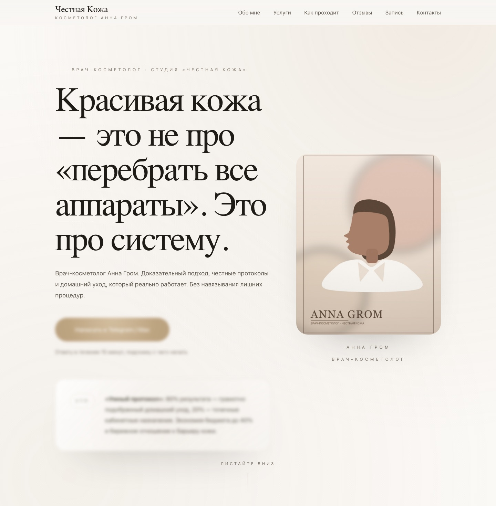
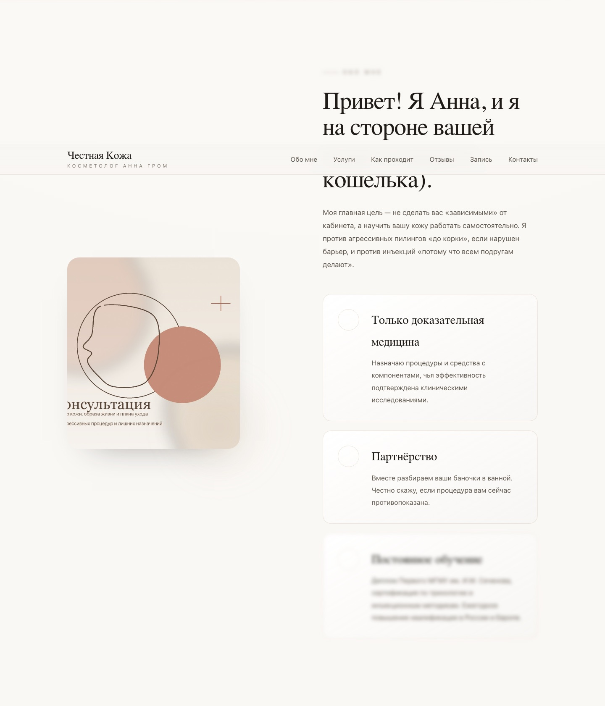
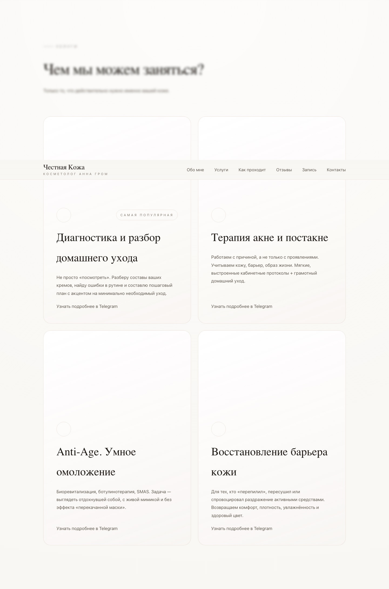
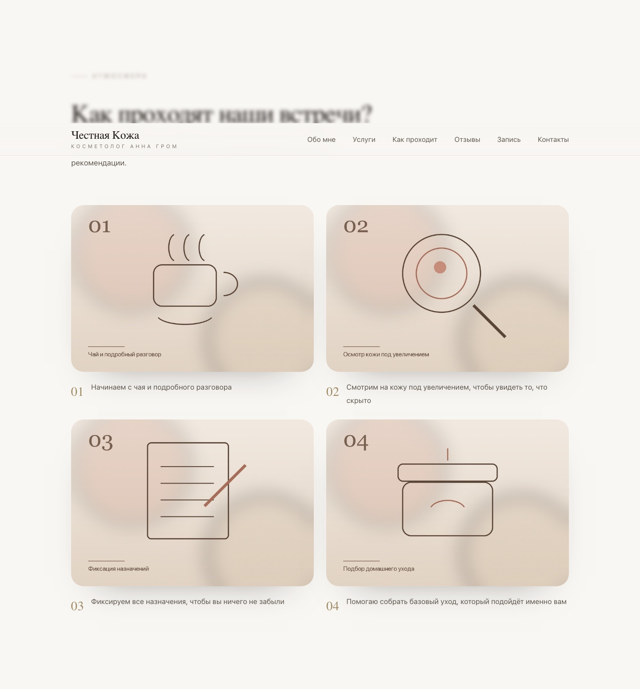
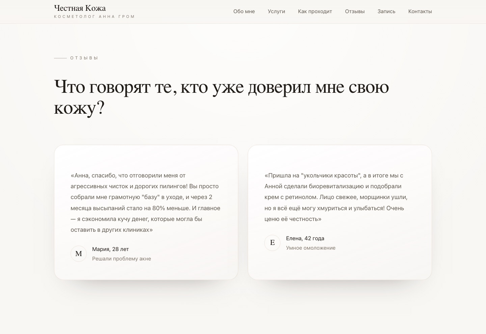
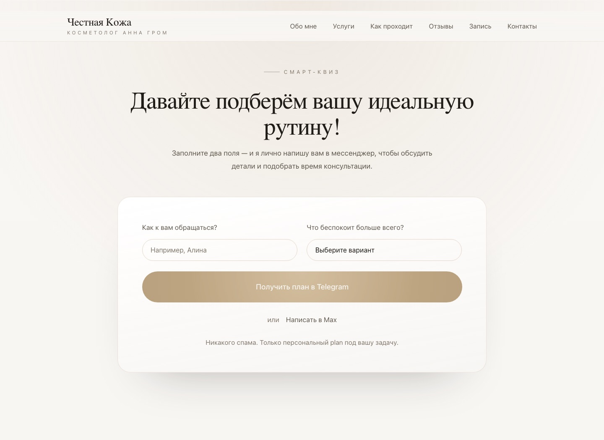
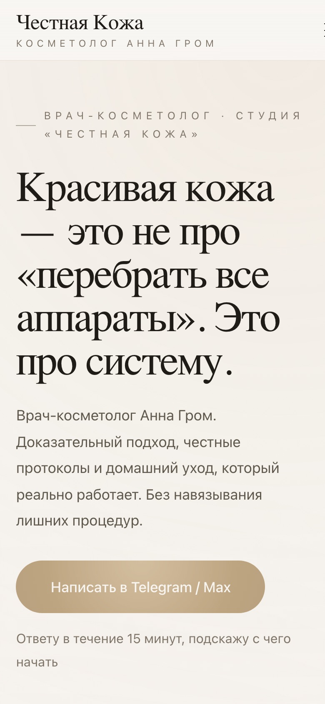

# «Честная Кожа» — лендинг врача-косметолога

Одностраничный сайт-визитка для частного косметолога Анны Гром. Продаёт не «процедуры», а подход: **80% результата — грамотный домашний уход, 20% — точечные кабинетные назначения**. Сайт снимает страх переплатить и мягко ведёт посетителя к записи через Telegram или MAX.

## Скриншоты















## Задача

У косметолога есть понятное УТП, но не было сайта, который объясняет его за 30 секунд. Нужно было:

- показать подход «сначала барьер кожи и домашний уход, потом кабинет»;
- снять возражения «мне опять продадут дорогие процедуры»;
- показать услуги, процесс приёма и реальные отзывы;
- превратить посетителя в заявку без звонков и менеджеров.

## Пользователь

- Женщины 25–45 лет с акне, возрастными изменениями, пигментацией или чувствительной кожей.
- Боятся агрессивных чисток и инъекций «потому что всем подругам делают».
- Хотят понять, сколько это стоит и что именно им нужно.
- Приходят с телефона из соцсетей и Telegram.

## Что реализовано

- Адаптивная вёрстка: десктоп, планшет, мобильный.
- Первый экран с УТП, портретом и понятным CTA.
- Блоки «Обо мне», «Услуги», «Как проходят встречи», «Отзывы», «Контакты».
- Форма «Давайте подберём вашу идеальную рутину»: имя + проблема → формируется готовый текст и открывается чат в Telegram или MAX.
- Анимации: появление блоков при скролле, лёгкий параллакс, «магнитные» кнопки.
- Мобильное меню, плавный скролл по якорям, доступные подписи полей.
- Без сборщика и зависимостей — открывается как статический сайт.

## Стек

- **HTML5** — семантическая разметка.
- **CSS3** — custom properties, Grid/Flex, `clamp()`, анимации.
- **Vanilla JavaScript** — `IntersectionObserver`, `FormData`, deep links в Telegram/MAX.
- **Google Fonts** — Cormorant + Inter.
- **Tabler Icons** — иконки.
- Без фреймворков и сборки.

## Как запустить

```bash
git clone https://github.com/Inaba1995/chestnaya-kozha-landing.git
cd chestnaya-kozha-landing
python3 -m http.server 8000
```

Открыть <http://localhost:8000>.

Можно и без сервера — просто открыть `index.html` в браузере.

## Структура

```
chestnaya-kozha-landing/
├── index.html          # вся разметка и тексты
├── assets/
│   ├── css/main.css    # стили, адаптив, анимации
│   ├── js/app.js       # меню, reveal, параллакс, форма
│   └── img/            # фото и графика
├── images/             # скриншоты для README
└── README.md
```

## Что можно улучшить

- Подключить реальную отправку заявок: Telegram-бот, CRM или Google Sheets.
- Добавить страницу с ценами и онлайн-запись.
- Подключить аналитику и цели на отправку формы.
- Заменить демо-фото на реальные снимки косметолога.
